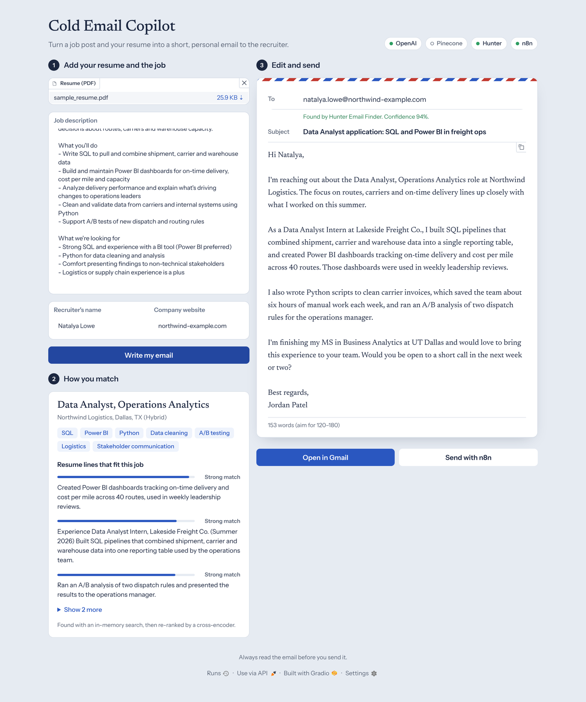
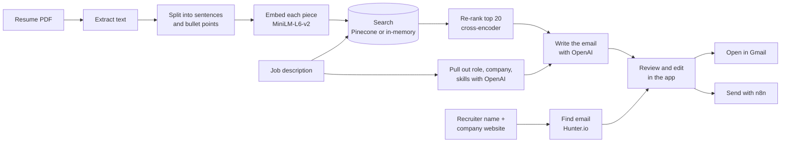

# Cold Email Copilot

Upload your resume, paste a job description, and get a short, personal email to the recruiter — with their work email looked up for you and one click to send it from Gmail.

<picture>
  <source media="(prefers-color-scheme: dark)" srcset="docs/screenshot-dark.png">
  
</picture>

<sub>The person and company in the screenshot are made up.</sub>

---

## Contents

- [Why I built this](#why-i-built-this)
- [What it does](#what-it-does)
- [How it works](#how-it-works)
- [Tech stack](#tech-stack)
- [Getting started](#getting-started)
- [Settings](#settings)
- [Optional: send emails with n8n](#optional-send-emails-with-n8n)
- [Running the tests](#running-the-tests)
- [Project structure](#project-structure)
- [Design choices](#design-choices)
- [Limitations and ideas](#limitations-and-ideas)

---

## Why I built this

As an international master's student in the US, I found that applying for jobs takes a lot of time:

- Every message needs to be **personal** to stand out.
- Finding the **recruiter's email** means digging through LinkedIn and email-finder tools.
- All of this happens on top of **classes, projects and networking**.

Cold outreach is one of the best ways to get interviews, but it's hard to keep up. This app does the slow parts for you:

> **Resume + job description → a tailored email in Gmail, addressed to the right person.**

---

## What it does

1. **Reads your resume** (PDF) and the job description you paste in.
2. **Pulls out the key details** of the job: role, company, location and top skills.
3. **Finds the lines in your resume that fit the job best** and shows how strong each match is.
4. **Looks up the recruiter's work email** with Hunter.io from their name and the company website.
5. **Writes a 120–180 word email** that mentions the role, highlights 2–3 real things from your resume, and asks for a short call. It only uses experience that's actually in your resume.
6. **Lets you edit and send**: change anything, copy it, open it in Gmail with everything filled in, or send it through an n8n workflow.

---

## How it works



This is a small **RAG** (retrieval-augmented generation) pipeline: instead of giving the model your whole resume, it first **retrieves** the few lines that match the job, then **generates** the email from those lines.

1. **Split.** The resume is broken into sentences and bullet points. Long ones are cut into overlapping pieces of up to 45 words.
2. **Embed.** Each piece becomes an embedding (a list of 384 numbers that captures its meaning) using `all-MiniLM-L6-v2`.
3. **Search.** The job description is embedded the same way and compared against your resume pieces. Pieces are stored in **Pinecone** if you set it up; otherwise the search runs in memory.
4. **Re-rank.** The top 20 results are scored again by a **cross-encoder** (`ms-marco-MiniLM-L-6-v2`), which reads the job description and each piece together. This is slower than embeddings but more accurate, so it's only used on the shortlist.
5. **Write.** OpenAI gets the job details, the top 5 resume lines and the top of your resume (for your name), and returns a subject line and email body as JSON.

---

## Tech stack

| Part | Tool |
| --- | --- |
| Web app | [Gradio 6](https://www.gradio.app/) with a custom theme (light and dark mode) |
| Reading PDFs | [pypdf](https://pypdf.readthedocs.io/) |
| Embeddings | [sentence-transformers](https://www.sbert.net/) `all-MiniLM-L6-v2` |
| Re-ranking | sentence-transformers cross-encoder `ms-marco-MiniLM-L-6-v2` |
| Vector database | [Pinecone](https://www.pinecone.io/) (optional) |
| Writing | [OpenAI API](https://platform.openai.com/) (`gpt-4.1-mini` by default) |
| Finding emails | [Hunter.io](https://hunter.io/) (optional) |
| Sending | Gmail compose link, or an [n8n](https://n8n.io/) webhook (optional) |
| Tests | pytest |

---

## Getting started

You need **Python 3.10 or newer** and an **OpenAI API key**. Everything else is optional.

**1. Clone the repo**

```bash
git clone https://github.com/rajatsxngh/cold-email-copilot.git
cd cold-email-copilot
```

**2. Create a virtual environment and install the packages**

```bash
python3 -m venv .venv
source .venv/bin/activate        # Windows: .venv\Scripts\activate
pip install -r requirements.txt
```

**3. Add your keys**

```bash
cp .env.example .env
```

Open `.env` and fill in at least `OPENAI_API_KEY`. See [Settings](#settings) for the rest.

**4. Run the app**

```bash
python -m src.app_gradio
```

Open the link it prints (usually http://127.0.0.1:7860).

> The first time you click **Write my email**, the two small Hugging Face models (about 90 MB each) are downloaded. After that, they load from your computer.

---

## Settings

All settings go in the `.env` file. The colored pills at the top of the app show which services are set up.

| Setting | Needed? | What it's for | If you leave it empty |
| --- | --- | --- | --- |
| `OPENAI_API_KEY` | **Yes** | Reads the job description and writes the email | The app can't write emails |
| `OPENAI_MODEL` | No | Which OpenAI model to use | Uses `gpt-4.1-mini` |
| `PINECONE_API_KEY` | No | Stores your resume pieces in Pinecone | Search runs in memory (works the same for one resume) |
| `PINECONE_INDEX_NAME` | No | Name of the Pinecone index (created for you if missing) | `cold-email-copilot` |
| `PINECONE_CLOUD`, `PINECONE_REGION` | No | Where Pinecone creates the index | `aws`, `us-east-1` |
| `HUNTER_API_KEY` | No | Finds the recruiter's email | You type the email yourself |
| `N8N_WEBHOOK_URL` | No | Sends the email through your n8n workflow | Use **Open in Gmail** instead |

> Never commit your `.env` file. It's already listed in `.gitignore`.

---

## Optional: send emails with n8n

**Open in Gmail** works without any setup. If you'd rather send straight from the app (and keep a log), connect an n8n workflow:

1. Start n8n (`npx n8n`) and open it, usually at http://localhost:5678.
2. Add a **Webhook** node: method `POST`, path `cold-email`. This gives you a URL like `http://localhost:5678/webhook/cold-email`. Put it in `.env` as `N8N_WEBHOOK_URL`.
3. Add a **Gmail** node after it, signed in with your Google account, and map the fields:
   - To → `{{ $json.body.to }}`
   - Subject → `{{ $json.body.subject }}`
   - Message → `{{ $json.body.body }}`
4. *(Optional)* Add a **Google Sheets** node to log `to`, `subject`, `job_title`, `company` and the time.
5. Turn the workflow on.

When you click **Send with n8n**, the app posts this JSON to the webhook:

```json
{
  "to": "recruiter@company.com",
  "subject": "…",
  "body": "…",
  "job_title": "Data Analyst",
  "company": "Northwind Logistics",
  "jd_url": ""
}
```

> Depending on your n8n version, the posted fields may sit under `$json.body` or directly under `$json`. Check the Webhook node's output and adjust the mappings if needed.

---

## Running the tests

The tests replace OpenAI, Pinecone, Hunter, n8n and the Hugging Face models with small fakes, so they run **offline, in a few seconds, with no API keys**.

```bash
pip install -r requirements-dev.txt
python -m pytest
```

They cover resume splitting, search and re-ranking (including Pinecone fallbacks), reading the model's replies, the Hunter lookup, input checks, the Gmail link and the n8n payload.

---

## Project structure

```text
cold-email-copilot/
├─ src/
│  ├─ app_gradio.py        # the web app: layout, theme and button actions
│  ├─ pipeline.py          # the main flow, from resume + job description to email
│  ├─ embeddings_index.py  # splitting the resume, embeddings, Pinecone search, re-ranking
│  ├─ openai_email.py      # reading the job description and writing the email
│  ├─ hunter_client.py     # finding the recruiter's email with Hunter.io
│  ├─ n8n_client.py        # sending the email through an n8n webhook
│  ├─ pdf_utils.py         # reading text from the resume PDF
│  └─ config.py            # settings from .env and API clients
├─ tests/                  # offline tests with fake services
├─ docs/                   # screenshots for this README
├─ .env.example            # template for your .env file
├─ requirements.txt
├─ requirements-dev.txt    # adds pytest
└─ README.md
```

---

## Design choices

- **No guessing on emails.** If Hunter can't find the recruiter, the app says so and leaves the field empty. It never falls back to someone else's address at the company.
- **Only real experience.** The writing prompt tells the model to use only what's in your resume: no made-up numbers, employers or degrees.
- **Your resume stays private.** It's read from Gradio's temporary upload and never copied into the project folder. With Pinecone on, only your current resume is kept: the old one is cleared each time.
- **Works with less.** Only OpenAI is required. Pinecone, Hunter and n8n each add something, but the app runs fine without them.
- **Reliable replies.** Both OpenAI calls ask for JSON and the replies are checked, so a reply wrapped in a code block or missing a field doesn't break the app.
- **Matches you can read.** The resume is split by sentence and bullet point, so "How you match" shows real lines from your resume, not random blocks of text.

---

## Limitations and ideas

- **Scanned resumes** (image-only PDFs) have no text to read. Export your resume as a text PDF.
- **One user at a time.** Everything is stored under one user ID, which is fine for running it on your own computer.
- **Ideas:** paste a job URL instead of the text, keep a history of sent emails, write follow-up emails, and offer a few tone options (formal, friendly, short).

---

**Always read the email before you send it**, and respect each company's and recruiter's communication preferences.
